# Insurance-IQ (Cardinal Ridge Insurance Group)

An AI Intelligence POC for a **fictional US property & casualty insurer**, *Cardinal Ridge Insurance Group*.
It writes **Auto, Homeowners, Commercial Property, General Liability and Workers' Comp** in **OH, TX, FL, CA, NY and IL**.

> Everything here is synthetic. simplified, fictionalised demo values

## What the app does

| UI NavigationTab | What it is | How it works |
|---|---|---|
| **Index Documents** | Upload PDFs and index everything in `sample_docs/` | Feeds the Q&A and the Agents' `search_company_guidelines` tool |
| **Company and State Policies Q&A (RAG)** | Ask plain-English questions about company and state policy documents | PDFs → chunks → embeddings (Chroma/Vertex) → Gemini answers only from retrieved text |
| **Insurance Assistant** | One agent that answers portfolio and claim questions | Tools: guarded read-only **SQL** over the DB, claim/coverage/fraud/compliance tools, and RAG over the PDFs |
| **Data Explorer** | Type a question in plain English **or** a SQL SELECT → the **Results in a UI** & **exact SQL that was executed** | `agent/data_explorer.py`: LLM writes the SQL from the live schema and executes agained our database |
| **Claims Review** | Type a claim id → a **team of 3 specialist agents + a Claims Director** produce a payment decision memo | Coverage · Fraud/SIU · Compliance agents (each with deterministic tools) → Director synthesis |
| **Underwriter Navigator** | Type a submission id (new business or renewal) → **risk assessment, pricing recommendation, loss-history review, a human-in-the-loop** referral gate and an Underwriters Memo | Application & Risk · Loss History · Referral Desk (HITL middleware) agents on a deterministic risk/pricing engine producing final underwiting memo |
| **System Status** | Mode, models, storage, vector store | — |

### 1. Index Documents

Add PDFs to the knowledge base by uploading them or indexing documents already in local storage or a GCS bucket. The app extracts text, splits it into searchable chunks, and stores their embeddings in the vector index. This makes company guidelines, policy forms and state summaries available to RAG Q&A and agents that search company guidelines.

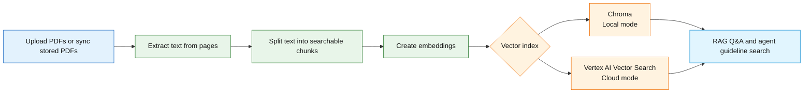
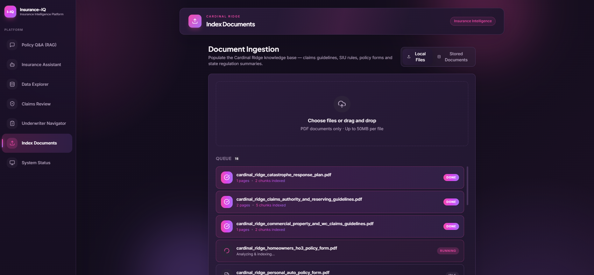


### 2. RAG QnA

Ask questions about the indexed company and state documents in plain English. The app finds relevant passages, then uses them to generate a concise answer; if the documents don't contain the answer, it should say so. Choose the default similarity search, contextual compression to trim retrieved passages, or multi-query search to broaden the search with alternate phrasings.

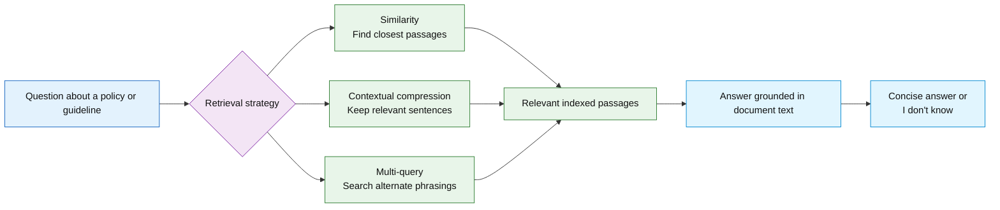
#### Question And Response
1. Response evidence in `./insurance-iq/sample_docs/cardinal_ridge_claims_authority_and_reserving_guidelines.pdf` file

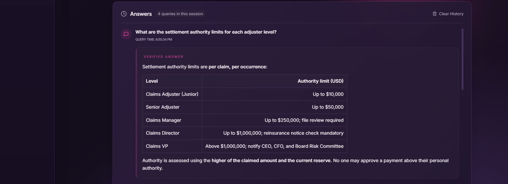 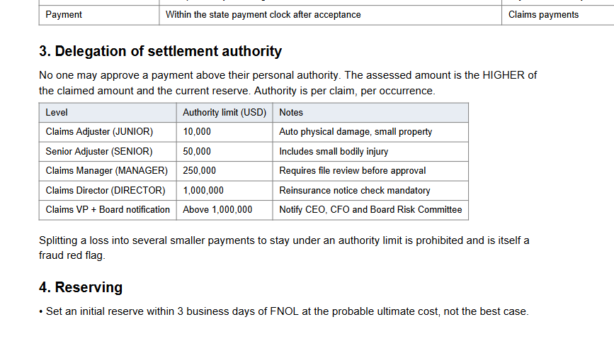

2. Response evidence in `./insurance-iq/sample_docs/state_fl_claims_regulations_summary.pdf` file

 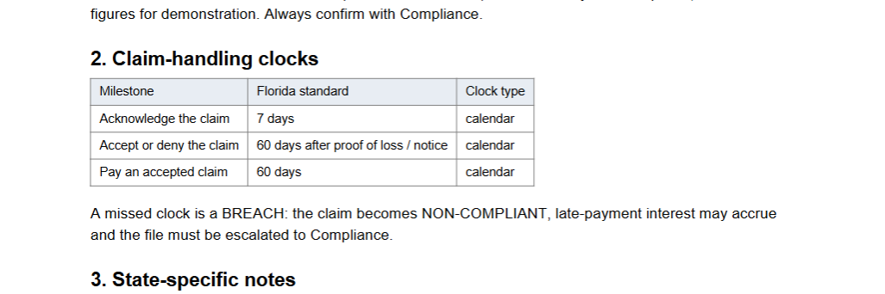


### 3. Insurance Assistant

Ask a broad portfolio or claim question in one place. The assistant selects from read-only SQL for portfolio analytics, claim and compliance tools for record-specific questions, and document search for policy rules. It uses tool results for figures and names the source document for policy answers.

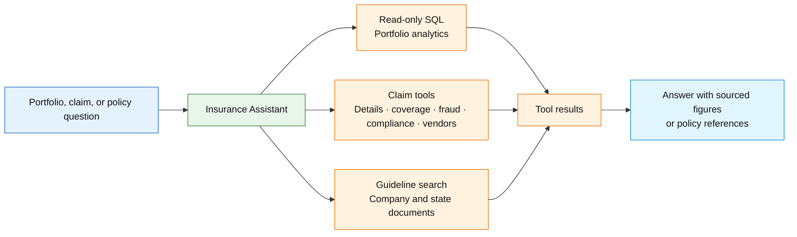

#### Question And Response
```text
    What does our SIU guideline say about reserving rights during an investigation? Can you score CLM-DEMO-05 for fraud and tell me what to investigate next.   
```
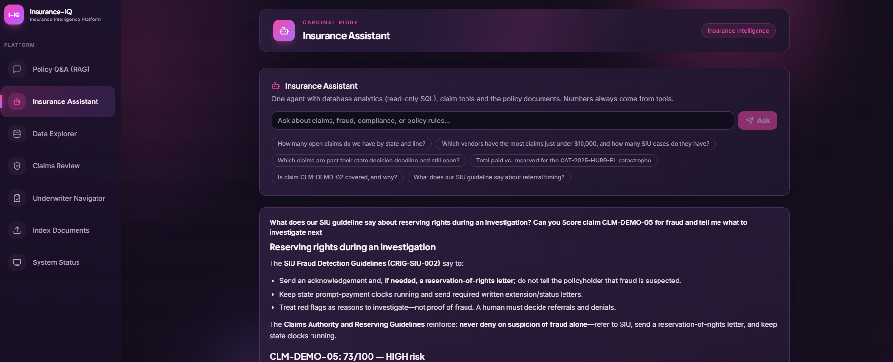 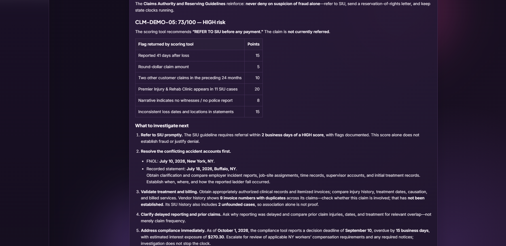

**Sources of Evidence**
1. Information about SIU guidelines from `cardinal_ridge_siu_fraud_detection_guidelines.pdf` file.

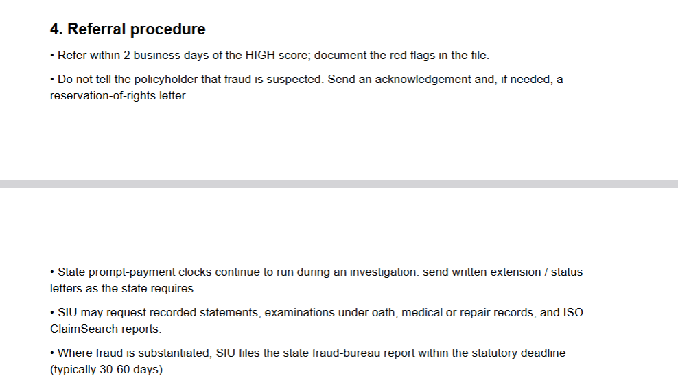

2. Information about claim `CLM-DEMO-05` and Numbers in RISK Score response, get information by asking our `Data Explorer`
```text
    Get information for claim CLM-DEMO-05 I need to get below information.
    1. Claim id, policy_id, customer_id, policy inception date, loss_date, reported_date, vendor id, vendor name (separate columns)
    2. Number of days between policy inception and loss occurred.
    2. Number of days between loss occurred and loss reported.
    3. Claim amount
    4. Count of SIU referred for a vendor associated with this claim
    5. Description
    6. How many more claims the customer of this claim is linked to in last 24 months.
```
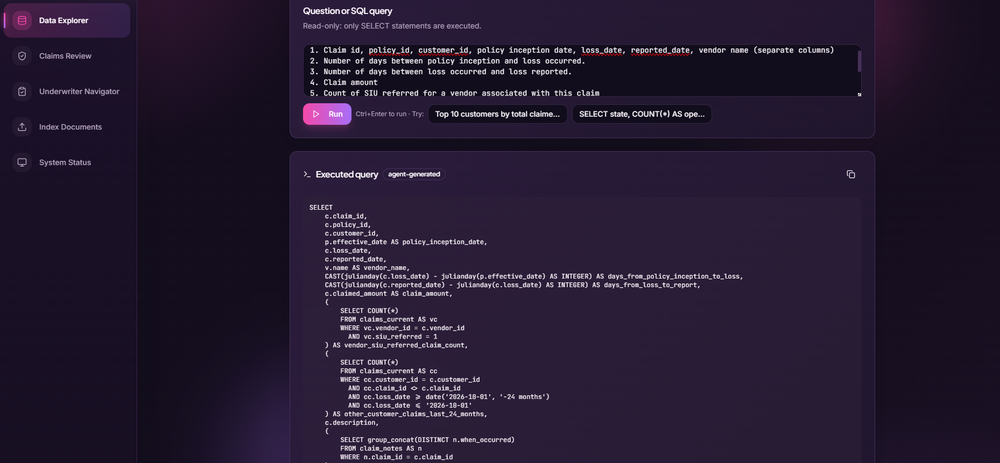
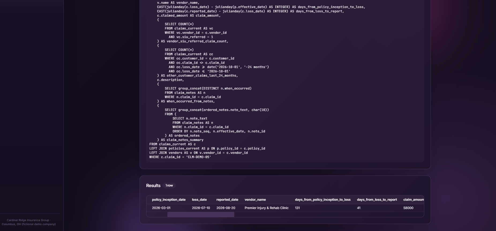


### 4. Claims Review
Enter a claim ID to get a decision memo based on three focused reviews: coverage, fraud/SIU risk, and state compliance and settlement authority. The Claims Director brings their findings together into a recommendation to approve, escalate, hold for SIU investigation, or deny, with reasons and follow-up actions.

| Step | Agent | What it does | Tools used |
|---|---|---|---|
| 1 | Coverage | Checks the claim and policy, determines whether the loss is covered, and reports the deductible, limit and estimated payable amount. | `get_claim_details`, `check_coverage`; `search_company_guidelines` when policy wording is needed |
| 2 | Fraud / SIU | Scores fraud indicators, checks for suspicious vendor patterns and recommends whether to refer the claim for investigation. | `score_fraud_indicators`, `lookup_vendor_history`; `get_claim_details` if the vendor ID is needed; `search_company_guidelines` optionally |
| 3 | Compliance & Authority | Checks state claim deadlines, settlement approval authority and any required escalation. | `check_state_compliance`, `check_settlement_authority`; `search_company_guidelines` optionally |
| 4 | Claims Director | Synthesizes the three specialist reports into a decision memo with rationale and required actions. | None; uses the specialist reports |

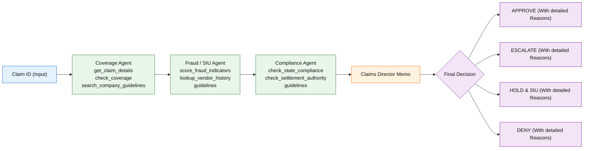

#### Question And Response
**1. Claim with Low risk**

```text
   Review claim CLM-DEMO-03  
```
**Response and Evidence from database for Amount Payable**

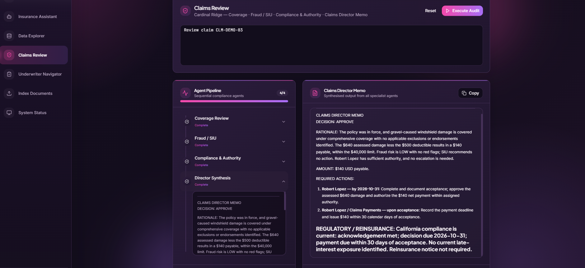
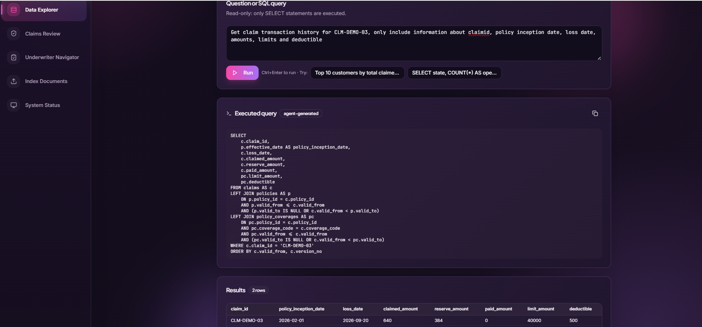

**2. Claim for Loss happned After Policy Was Cancelled**

```text
   Review claim CLM-DEMO-06  
```
**Response and Evidence from database to check if loss happened after Policy Cancellation**

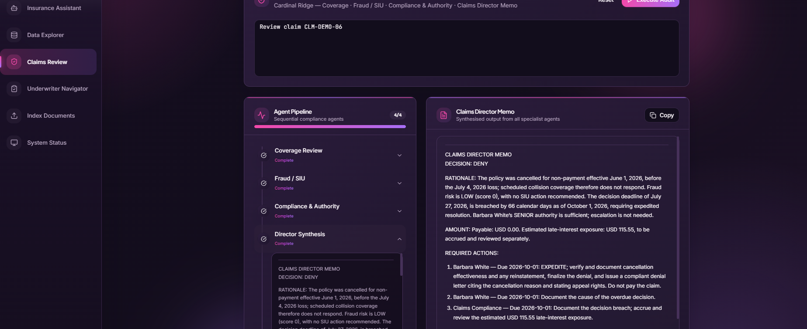
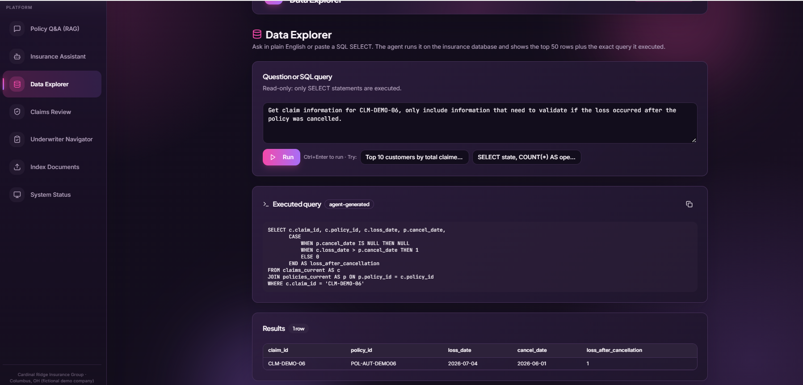


### 5. Underwriter Navigator

Enter a submission ID to assess a **new business application or renewal**. The workflow combines a deterministic risk and pricing assessment with the applicant's loss history, then produces an Underwriters Memo with a recommendation and next steps. When a submission requires referral, a human can review, approve, edit, or reject it before the memo is completed.

| Step | Agent | What it does | Tools used |
|---|---|---|---|
| 1 | Application & Risk | Reads the application + notes, calls the deterministic risk engine (score 0-100, tier, indicated premium, required authority, conditions), cites the guidelines | `get_submission`, `assess_submission_risk`, `search_company_guidelines` |
| 2 | Loss History | Existing customers: policies, latest claim versions, SIU flags and the underwriting insights from `claim_notes` | `get_applicant_loss_history`, `get_submission`, `search_company_guidelines` |
| 3 | Referral Desk (**HITL**) | If a referral is required it calls `request_manual_review`; LangChain's `HumanInTheLoopMiddleware` pauses the run until a human **approves, edits or rejects** it | `assess_submission_risk`, `request_manual_review` |
| 4 | Underwriters Memo | One LLM call writes the memo (recommendation, risk, pricing, authority, conditions, next steps) | None; synthesizes the agent reports |

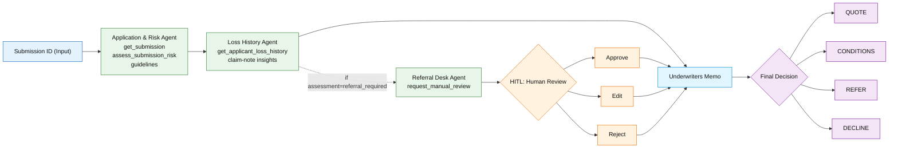

#### Question And Response
**1. Application Submission with 0 Risk - No HITL**

```text
    Underwrite submission SUB-DEMO-01.   
```
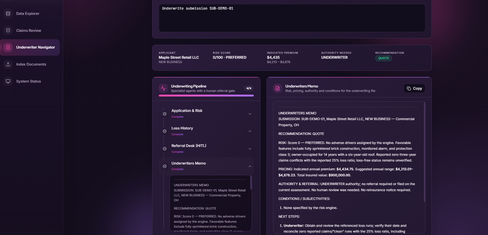

**2. Application Submission with High Risk - Need HITL**

```text
    Underwrite submission SUB-DEMO-04 and tell me if reinsurance must be notified. Escalate to the right authority.   
```

**Human-In-The-Loop Pause - Asking for decisiion**
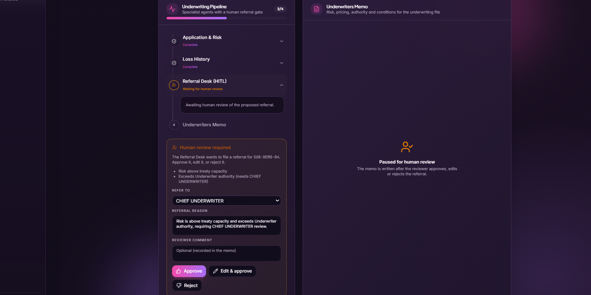

**Human-In-The-Loop After Decision (Approve)**
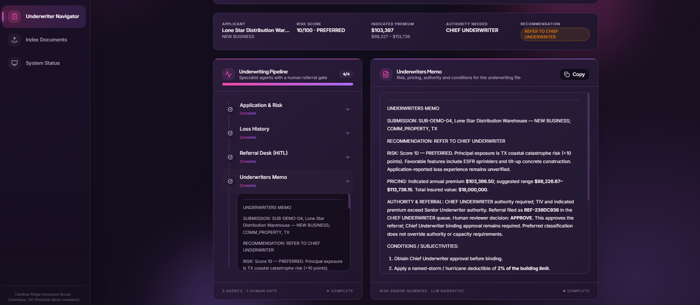


### 6. Data Explorer

Ask a question in plain English or enter a SQL `SELECT` to explore the insurance database. For natural-language questions, an agent builds a query from the live database schema; for SQL, it runs your query as written. Queries are read-only, and results show the executed SQL alongside up to 50 rows so you can inspect or copy the query.

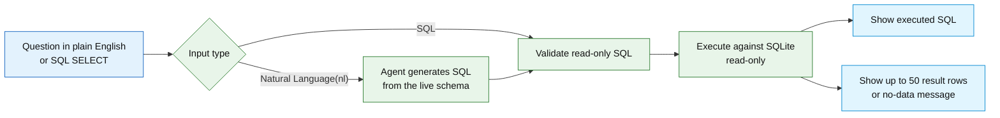

#### Question And Response
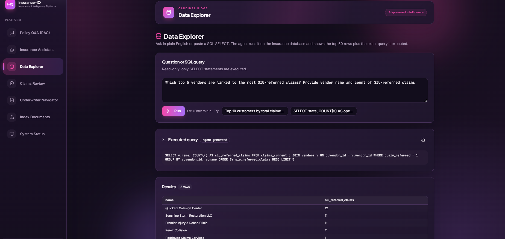

## 2. Setup Environment & Run.
This guide runs the project **locally only**: vectors are stored in Chroma on disk and no Google Cloud project is needed.

### 1. Setup to run project locally

**Prerequisites:** Git, [uv](https://docs.astral.sh/uv/), Python 3.12+, Node 18+ (for the UI), and an API key for your LLM provider ([OpenAI](https://platform.openai.com/api-keys) or [Gemini](https://aistudio.google.com/apikey)).

1. **Clone the repository**

    ```powershell
        git clone https://github.com/pasrichashivam/insurance-iq.git
        cd insurance-iq
    ```

2. **Create a virtual environment and install libraries with uv**
    ```powershell
        uv sync
    ```
    `uv sync` creates `.venv` and installs the dependencies from `pyproject.toml` / `uv.lock`.

3.  **Create the env file and update the API keys and settings**

    ```powershell
        copy .env.example .env
    ```
    Open `.env` and update:

    | Setting | What to set |
    |---|---|
    | `APP_MODE` | Keep `local` |
    | `LLM_PROVIDER` | `openai` (default) |
    | `OPENAI_API_KEY` | The key for the provider you chose |
    | `LLM_MODEL_NAME`, `LOCAL_EMBEDDING_MODEL_NAME` | Optional model overrides (defaults: `gpt-6.1-sol` / `text-embedding-3-small` for OpenAI) |

### 2. Insurance Company Synthetic Data
The data for the fictional Cardinal Ridge Insurance Group is **already committed**, so there is nothing to generate:
- `backend/data/cardinal_ridge.db` is the SQLite database the app queries, and `insurance_data/csv/` holds the same tables as CSV files.
- `sample_docs/*.pdf` holds 15 company and state policy documents used for RAG and guideline search.

#### Database tables

| Table | Rows | Purpose |
|---|---|---|
| policyholders | 1,206 | Individuals and businesses (credit tier, address changes) |
| policies / policy_coverages | 2,752 / 11,413 | Policy periods, cancellations, limits, deductibles |
| claims | 1,616 | Status OPEN / UNDER_INVESTIGATION / APPROVED / PAID / DENIED; ~2 years of losses |
| claim_payments | 1,570 | Payment ledger |
| adjusters | 30 | Levels JUNIOR $10k · SENIOR $50k · MANAGER $250k · DIRECTOR $1M |
| vendors | 63 | Body shops, contractors, clinics |
| siu_cases | 59 | Special-investigation history |
| underwriting_submissions | 165 | New-business and renewal applications |
| catastrophe_events | 3 | HURR, HAIL |
| reinsurance_treaties | 3 | Property CAT XOL, Auto Quota Share, Casualty XOL |
| state_regulations | 6 | Simplified claim clocks per state |

Also exported as CSV in `insurance_data/csv/` & the SQLite file used by the app is `backend/data/cardinal_ridge.db`.

#### Company and State Policy documents (`sample_docs/`, 15 PDFs)
* Company: Claims Handling, Authority & Reserving Guidelines · SIU Fraud Detection Guidelines · Underwriting Guidelines · Homeowners HO-3 Form ·
* Personal Auto Form · Catastrophe Response Plan · Reinsurance Treaty Summary · Privacy & Data Protection (GLBA, AI use) ·
* Commercial Property & Workers' Comp Claims Guidelines.
* State: Claims-regulation summaries for **TX, FL, CA, NY, OH, IL** (acknowledge / decide / pay clocks, business vs calendar days).

The numbers in the PDFs match the database tables, so RAG answers and tool results agree.

### 3. Run Backend and Frontend
1. **Run the backend**

API docs are available at http://localhost:8080/docs
    ```powershell
        uv run uvicorn api.main:app --app-dir backend --reload --port 8080
    ```

2. **Run the frontend (in a new terminal)**
    ```powershell
        cd frontend
        npm install
        npm run dev
    ```
    Open the URL printed by Vite (typically http://localhost:3000).

> **First-run step:** open **Index Documents** and click *Index Stored Documents* and upload the PDF files we have in `sample_docs` and click Initialize Ingestion.  <br>
>This embeds the 15 PDFs so Q&A and the agents' guideline search work. The SQL, coverage, fraud and compliance tools work without it.

## Sample questions used for testing system

### 1. Q&A | Companies internal documents and state policies | (RAG over PDFs)

| Question | Expected evidence |
|----|---|
| What are the settlement authority limits for each adjuster level? | `cardinal_ridge_claims_authority_and_reserving_guidelines.pdf`; JUNIOR $10k · SENIOR $50k · MANAGER $250k · DIRECTOR $1M. The DB must match the PDF |
| How many days does Florida allow to accept or deny a claim, and are they calendar or business days? | `state_fl_claims_regulations_summary.pdf` p.1: acknowledge 7, decide 60, pay 60, **calendar** days |
| Which red flags raise a fraud score and what score triggers an SIU referral? | `cardinal_ridge_siu_fraud_detection_guidelines.pdf` p.1: HIGH ≥ 50 = refer before any payment; 25–49 MEDIUM; flag list in section 2/3. Cross-check against the flags in `score_fraud_indicators` output |
| Is flood damage covered by the HO-3 form? What is the hurricane deductible? | `cardinal_ridge_homeowners_ho3_policy_form.pdf`: flood excluded (endorsement available); FL/TX named-hurricane deductible = percentage of the dwelling limit (2%) |
| When must reinsurers be notified of a large claim? | `cardinal_ridge_reinsurance_treaty_summary.pdf` p.1: report within 5 business days once the claim reaches the treaty notice threshold (property/casualty XOL $500k, auto $1M) |
| What are Texas's prompt-payment deadlines? | `state_tx_claims_regulations_summary.pdf`: acknowledge 15, decide 15, pay 5 — all **business** days; the DB row (TX, 15, 15, 5, business) must agree |
| What does the privacy policy say about using AI in claim decisions? | `cardinal_ridge_privacy_and_data_protection_policy.pdf` §2 "Use of AI": decision support only, a licensed human decides coverage, denial and fraud referral; outputs must be explainable |
| What are the underwriting referral limits for a Senior Underwriter? | `cardinal_ridge_underwriting_guidelines.pdf` §1 table: Senior UW up to $100k premium, $10M TIV, 4 claims in 3 years. Same numbers are coded in `agent/underwriting_tools.py` (`UW_AUTHORITY`) |
| What is the average 3-year loss ratio of submissions in REFER_TO_SENIOR_UW status by state?  | CA 0.82 (19), FL 0.85 (29), IL 0.95 (9), NY 0.95 (18), OH 1.04 (26), TX 0.89 (32) |
| What does the underwriting guideline say about roof age above 20 years and contractor risks?  | `cardinal_ridge_underwriting_guidelines.pdf`: roof > 20 yrs → ACV for wind/hail; contractors need subcontractor certificates and a written safety program. |

### 2. Claims Review (agents)

**Validate every claim review** by re-running its tools and comparing with the memo (the memo may never change a tool figure):
```python
  from agent.tools import *
  [print(t.invoke({'claim_id':'CLM-DEMO-01'})) for t in (check_coverage, score_fraud_indicators, check_state_compliance, check_settlement_authority)]
```

| Question | Expected |
|---|---|
| `Review claim CLM-DEMO-01` | Score **100 (HIGH)**, flags: 12 days after inception (+20), reported 38 days after loss (+15), $9,850 just under $10k (+15), VND-901 in 12 SIU cases (+20), 2 address changes (+8), no police report (+8), duplicate invoice INV-901-44540 on 5 other claims (+20), inconsistent statements in the notes (+15) → hold & refer to SIU; TX clock NON-COMPLIANT |
| `Review claim CLM-DEMO-02` | cause FLOOD, `flood_cov = 0` → NOT COVERED, deny; FL 60-day clock breached (see `check_state_compliance`) |
| `Review claim CLM-DEMO-03` | $640 glass, covered, payable = $640 − $500 deductible = **$140**, fraud LOW |
| `Review claim CLM-DEMO-04` | $620,000 > MANAGER $250k → required level DIRECTOR; assigned adjuster only SENIOR (`adjuster_has_authority: false`) → escalation; $620k ≥ $500k → reinsurance notice |
| `Review claim CLM-DEMO-05` | Score **73 (HIGH)**: reported 41 days after loss (+15), round-dollar amount (+5), 2 other claims by the customer (+10), VND-903 in 11 SIU cases (+20), no witnesses (+8), inconsistent statements (+15); $58,000 → MANAGER; NY clock NON-COMPLIANT. `get_claim_notes` shows the contradicting recorded statement |
| `Review claim CLM-DEMO-06` | loss 2026-07-04 is after the 2026-06-01 NON_PAYMENT cancellation → NOT COVERED |
| `Review claim CLM-2026-000123` (any real id) | The memo's amounts, status and dates must equal that row; history shows each dated change |

### 3. Insurance Assistant (SQL + tools + docs) | General Agent
* To validate ask the assistant to **show the SQL it ran if interacted with DB**
* Then run that query yourself and compare. Numbers are expected to match exactly.
* For answers returned by Docs need to backtract to PDF files. (TODO: Citation in Agent Response)

| Question | Expected on this dataset |
|---|---|
| How many claims are open or under investigation by state and line? | Top rows: FL/HOME OPEN 21, TX/AUTO OPEN 21, IL/AUTO OPEN 16. Wrong if it counted `claims` (all versions) instead of `claims_current` |
| Which five vendors have the most claims between $9,000 and $9,999, and how many SIU cases does each have? | VND-901 (23 / 12 SIU), VND-903 (22 / 11), VND-902 (22 / 11), then VND-013, VND-052 |
| List open claims that are past their state decision deadline. | 20 rows. The business-day conversion is approximate, so borderline claims may differ by a few days: confirm one with `check_state_compliance` |
| Total claimed vs paid for CAT-2025-HURR-FL, split by status. | DENIED 4 · $194,664.07 claimed · $0 paid; PAID 17 · $348,386.06 claimed · $277,157.63 paid |
| Which adjusters are working claims above their authority limit? | Top: ADJ-026 Daniel Jackson (JUNIOR, 11), ADJ-015 Priya Lewis (9), ADJ-019 Priya Hill (7) |
| Which customers have 3+ claims in the last 24 months? | Top: CUS-00724 (8), CUS-00516 (7), CUS-00403 (7). "Last 24 months" is measured from 2026-10-01, not the real today |
| Show denied claims and the top denial reasons. | Top reason: "Flood is excluded under the HO-3 form; no flood endorsement on policy." (37). Compare the full list with the AI's list |
| Is CLM-DEMO-06 covered? Why or why not? | Policy CANCELLED 2026-06-01 (NON_PAYMENT) before the 2026-07-04 loss → NOT COVERED |
| Score CLM-DEMO-05 for fraud and tell me what to investigate next. | Score is the sum of the listed flags (check the arithmetic), band HIGH if ≥ 50; flags must each be explained by the DB facts (late report 41 days, VND-903 SIU cases, no witnesses) |
| What does our SIU guideline say about reserving rights during an investigation? | `cardinal_ridge_siu_fraud_detection_guidelines.pdf` p.1: ... reservation-of-rights letter. Also run `python -m rag.trace_sources "reserving rights during an investigation"` |

### 4. Underwriter Navigator
* To validate ask the assistant to **show the SQL it ran if interacted with DB**
* Then run that query yourself and compare. Numbers are expected to match exactly.
* For answers returned by Docs need to backtrack to PDF files. (TODO: Citation in Agent Response)

| Query | Expected (engine) | Extra validation |
|---|---|---|
| Underwrite submission SUB-DEMO-01 | RISK Score 0 - PREFERRED, PRICING ≈ $4,435, RECOMMENDATION-QUOTE, no referral, no human pause | $900k TIV × 0.6% = $5,400 base × state 1.0 × tier 0.9 × loss factor 0.912 = $4,434.75; range $4,213–$4,878; authority Underwriter (under $25k / $2M / 2 claims) |
| Underwrite submission SUB-DEMO-02. Applicant requests replacement-cost coverage. | RISK Score 87, HIGH, DECLINE, referral to Senior UW pauses for review | Row shows loss ratio 115%, 4 claims, roof 24 yrs, "prior carrier non-renewed", FL coastal; guideline: roof > 20 yrs → ACV only |
| Underwrite submission SUB-DEMO-03 | RENEWAL / existing customer, score 62, ELEVATED, REFER TO SENIOR UNDERWRITER, safety-program condition | Shows the SIU-referred claim CLM-2026-001609 (the referral reason) and the open claim CLM-DEMO-05 (reserve $52,200); guideline "contractor risks require certificates of insurance and a written safety program" |
| Underwrite submission SUB-DEMO-04 and tell me if reinsurance must be notified. | Score 10, premium ≈ $103k, CHIEF UNDERWRITER, reinsurance notice | $18M TIV > $10M Senior limit and premium > $100k|
| Renew and increase the building limit for SUB-DEMO-05. How does the open fire claim affect it? | RENEWAL, score 23, Senior UW (TIV $3M > $2M), open-claim condition | The quoted insight ("Severity loss: review electrical / heating inspections, sprinkler status and protection class at renewal.") must come from `claim_notes.underwriting_insights` |
| Underwrite submission SUB-DEMO-04 ($18M warehouse) | Score 10, **REFER TO CHIEF UNDERWRITER**, reinsurance notice condition |
| Underwrite submission SUB-DEMO-05 (renewal after fire claim) | RENEWAL, Senior UW (TIV > $2M), open-claim condition |

#### Queries that trigger the Human-in-the-Loop pause
The agent calls `request_manual_review` only when a referral is required, `HumanInTheLoopMiddleware` then pauses the run and the tab shows **Approve / Edit / Reject**.

|  Query | Why it pauses | What to do and expect |
|---|---|---|
| Underwrite submission SUB-DEMO-03 — what price range would you quote and who must approve it? | Range = `pricing.suggested_range` (95%–110% of indicated premium); approver = `required_authority` | Compare both numbers with the engine output above. HITL check: on a paused run, Approve / Edit / Reject must change the "HUMAN REVIEW" line in the memo, and a second review of the same `thread_id` returns 400 |
| Underwrite submission SUB-DEMO-03 and refer it if needed. | Score 62 (ELEVATED), SIU-referred claim CLM-2026-001609 → hard referral reason; required authority Senior Underwriter | **Approve** → memo "HUMAN REVIEW: approved", premium unchanged ($23,388.75). **Edit** (change authority to Chief Underwriter, add a reason) → memo shows your edited authority/reason. **Reject** → memo records the referral as rejected and keeps the engine recommendation. Re-submitting the same `thread_id` returns 400 |
| Underwrite submission SUB-DEMO-04 and tell me if reinsurance must be notified. Escalate to the right authority. | $18M TIV > $10M → reinsurance/Chief Underwriter referral | The pause shows authority CHIEF UNDERWRITER and the reinsurance reason; after Approve the memo carries the reinsurance notice and the ≈ $103k premium |

### 5. Data Explorer
Type a **Natural Language question or a SQL query** it shows
1. Executed query box 
2. Results in scrollable table with at most `50 rows`.

**How it decides (`POST /api/agent/data-explorer {"query": "..."}`):**
- If query starts with `SELECT` / `WITH`  your SQL is validated and executed as written (`mode: sql`).
- Else the LLM writes one `SQLite SELECT` from the live schema (`mode: nl`), if it errors the agent retries once with the error message.
- No rows, an unknown table/column, or a question the data cannot answer (the LLM answers `NO_DATA`).
- Writes/DDL or multiple statements are refused the database is opened read-only and queries stop after 10 s.
- Response: `status, mode, message, sql, columns, rows, row_count, truncated, detail`. Use the `*_current` views for "latest".

| Input | Type | Expected result |
|---|---|---|
| SELECT state, COUNT(*) AS open_claims FROM claims_current WHERE status='OPEN' GROUP BY state ORDER BY open_claims DESC | SQL | 6 rows: TX 45, FL 37, OH 34, IL 32, CA 27, NY 20. Executed query = your text |
| Top 10 customers by total claimed amount` | NL | 10 rows from `claims_current` joined/grouped by customer, sorted by the sum descending; the SQL box shows the generated query. Validate by pasting that SQL back as input #1-style SQL or with `run_sql.py |
| Which vendors are linked to the most SIU-referred claims? | NL | Generated query over `claims_current.siu_referred=1` grouped by `vendor_id`; the top named vendors are VND-901 (12) and VND-903 (11) (a NULL vendor group of 18 may also appear) |
| SELECT submission_id, status, total_insured_value FROM underwriting_submissions WHERE submission_id LIKE 'SUB-DEMO%' | SQL | 5 rows SUB-DEMO-01..05, all PENDING_REVIEW, TIV 900k / 4.5M / 1.8M / 18M / 3M |
| List the Director-level adjusters with their state and authority limit | NL | Rows from `adjusters` where `level='DIRECTOR'` (e.g. Priya Young TX $1,000,000; Nicole Miller FL $1,000,000) |
| What is the weather in Columbus today? | NL | Table empty, message **No information available for the query**, nothing executed |
| SELECT * FROM weather | SQL | Same message, `detail: SQL error: no such table: weather` |
| DELETE FROM claims | SQL | Refused: "Only read-only queries are allowed…" — no change to the database |

## 5. Limits & disclaimers
- Synthetic data and fictional company; simplified state rules — verify real law before any production use.
- AI output is decision support. A licensed human must decide coverage, denial and fraud referrals.
- Fraud score weights are illustrative heuristics, not a validated model; check for fairness/bias before real use.
